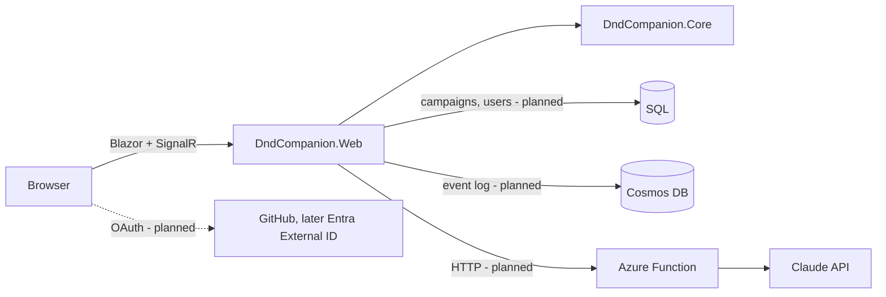

# Architecture

Target architecture (phases 2-3 are **planned**, not built).

- **Core** holds pure rules and is the only project unit-tested heavily.
- **Web** owns UI, the SignalR hub and (later) auth and persistence.
- **Function** keeps the Claude API key out of the web app and runs async, occasional work.
